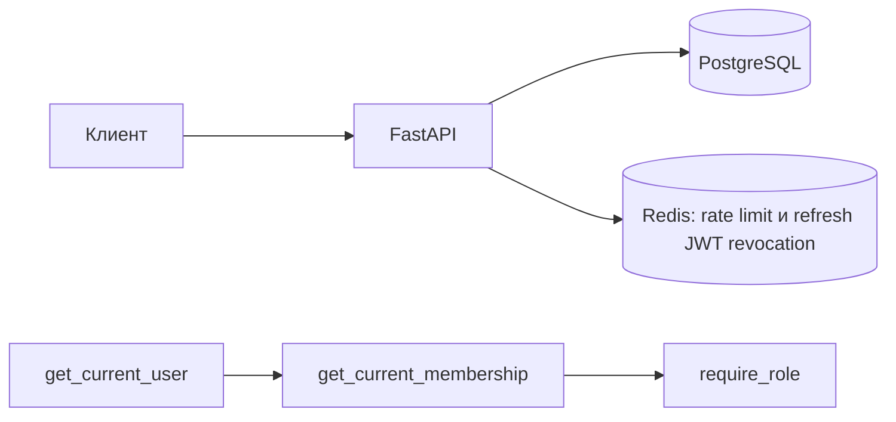

# Multitenant Task Management SaaS

[](https://github.com/MalaysiaSurfer/MultitenantTaskManagementSaaS/actions/workflows/ci.yml)

Мини-Trello/Jira: организации, роли, проекты, задачи. FastAPI, PostgreSQL,
SQLAlchemy 2.0 (async), Alembic, Redis, Docker Compose.

## Запуск

```bash
cp .env.example .env
# Сгенерируйте ключ: openssl rand -hex 32
# Заполните POSTGRES_PASSWORD, SECRET_KEY и DATABASE_URL в .env
docker compose -f docker-compose.yml -f docker-compose.dev.yml up -d --build
docker compose -f docker-compose.yml -f docker-compose.dev.yml exec api alembic upgrade head
```

Swagger: http://localhost:8000/docs

## Dev и prod

`docker-compose.yml` — базовая production-конфигурация: без reload и без публикации портов PostgreSQL и Redis; безопасный режим по умолчанию — `prod`. Для разработки явно добавьте `docker-compose.dev.yml`: `docker compose -f docker-compose.yml -f docker-compose.dev.yml up --build`. Dev-файл включает reload, исходники как volumes, `ENVIRONMENT=dev` и порты БД/Redis, привязанные только к `127.0.0.1`. Compose не подхватывает его автоматически. Перед запуском заполните `.env`: задайте `POSTGRES_PASSWORD`, согласованный `DATABASE_URL` и сгенерируйте `SECRET_KEY` командой `openssl rand -hex 32`.

В production всегда используется `ENVIRONMENT=prod` (или задайте `APP_ENVIRONMENT` для другого режима), JSON-логирование принудительно включено, а слабый `SECRET_KEY` завершает запуск ошибкой. Swagger, ReDoc и OpenAPI выключены. Docker CMD использует `--proxy-headers`, `--forwarded-allow-ips` и `--no-access-log`; список доверенных прокси задаётся через `FORWARDED_ALLOW_IPS` и по умолчанию ограничен `127.0.0.1`. Прокси сейчас не входит в compose. При размещении за reverse proxy укажите его конкретный IP/CIDR; не задавайте `*`, иначе клиент сможет подделать IP и обходить лимитер. Без прокси Uvicorn использует адрес прямого клиента, X-Forwarded-For не читается приложением.

## Конфигурация

| Переменная | Обязательна | По умолчанию | Назначение |
|---|---:|---|---|
| `ENVIRONMENT` | нет | `prod` | `dev`, `test` или `prod`; в dev-образе задаётся явно |
| `APP_ENVIRONMENT` | нет | `prod` | Переопределение `ENVIRONMENT` для базового Compose |
| `SECRET_KEY` | да | — | Ключ JWT; в prod не короче 32 символов и не placeholder |
| `DATABASE_URL` | да | — | Async URL PostgreSQL |
| `POSTGRES_USER` | compose | — | Пользователь PostgreSQL |
| `POSTGRES_PASSWORD` | compose | — | Пароль PostgreSQL из `.env` |
| `POSTGRES_DB` | compose | — | Имя БД |
| `REDIS_URL` | нет | `redis://redis:6379/0` | Redis для rate limit и отзыва refresh JWT |
| `ACCESS_TOKEN_EXPIRE_MINUTES` | нет | `15` | Срок access JWT |
| `REFRESH_TOKEN_EXPIRE_DAYS` | нет | `30` | Срок refresh JWT |
| `INVITATION_EXPIRE_DAYS` | нет | `7` | Срок приглашения |
| `LOG_LEVEL` | нет | `INFO` | Уровень логирования |
| `LOG_JSON` | нет | `false` (`true` в prod) | JSON-формат логов |
| `SQL_ECHO` | нет | `false` | SQLAlchemy echo |
| `LOGIN_RATE_LIMIT_ATTEMPTS` | нет | `5` | Неудачи на пару IP/email за окно |
| `LOGIN_RATE_LIMIT_WINDOW_SECONDS` | нет | `300` | Длина окна rate limit |
| `LOGIN_RATE_LIMIT_IP_MULTIPLIER` | нет | `5` | Порог IP относительно порога пары |
| `FORWARDED_ALLOW_IPS` | нет | `127.0.0.1` | Доверенные прокси для Uvicorn |
| `SMTP_HOST` | для писем | — | SMTP-сервер; без него письма с приглашениями не отправляются |
| `SMTP_PORT` | нет | `587` | Порт SMTP |
| `SMTP_USERNAME` / `SMTP_PASSWORD` | нет | — | Логин SMTP; без `SMTP_USERNAME` вход не выполняется |
| `SMTP_STARTTLS` | нет | `true` | Включать STARTTLS перед отправкой |
| `SMTP_TIMEOUT_SECONDS` | нет | `10` | Таймаут соединения с SMTP |
| `MAIL_FROM` | нет | `noreply@localhost` | Адрес отправителя |
| `INVITATION_ACCEPT_URL` | нет | — | Ссылка во фронтенд с плейсхолдером `{token}`, например `https://app.example.com/invite?token={token}`; без неё в письме передаётся сам токен |

## Архитектура



## Аутентификация

| Эндпоинт | Что делает |
|---|---|
| `POST /auth/register` | Создаёт пользователя и его первую организацию с ролью `owner`; пароль от 8 до 128 символов |
| `POST /auth/login` | OAuth2 password form (`username` = email); возвращает пару access/refresh JWT |
| `POST /auth/refresh` | Обменивает refresh на новую пару; старый refresh больше не принимается |
| `POST /auth/logout` | Отзывает переданный refresh-токен |
| `POST /auth/logout-all` | Завершает все сессии пользователя: отзывает refresh- и access-токены |
| `POST /auth/password` | Меняет пароль по текущему и завершает все сессии, включая текущую |
| `GET /auth/me` | Текущий пользователь |

Access-токен передаётся в `Authorization: Bearer <token>`. Регистрация ограничена тем же механизмом, что и вход (см. ниже).

Каждый токен несёт поколение сессий пользователя (`sv`), а текущее поколение хранится в Redis. `logout-all` и смена пароля увеличивают его, поэтому все ранее выданные токены, и refresh, и access, перестают приниматься сразу, без ожидания `ACCESS_TOKEN_EXPIRE_MINUTES`. Проверка access-токена читает поколение из Redis на каждом запросе и действует fail-closed: если Redis недоступен, защищённые эндпоинты отвечают `503`.

## Ограничение попыток входа

Используется fixed window: Lua-скрипт атомарно проверяет оба счётчика, резервирует попытку и выставляет `EXPIRE` при первом значении до проверки пароля. Это закрывает check-then-act гонку при параллельных запросах. Отдельные ключи считают IP и пару `(IP, нормализованный email)`; email в ключе хэшируется. Пара блокируется после заданного числа зарезервированных попыток, общий IP-порог задаётся множителем, чтобы NAT-порог был выше. Успешный вход удаляет счётчик пары и освобождает одну IP-резервацию, поэтому успешные пользователи не расходуют общий лимит. Неудачные проверки остаются посчитанными. Лимитер не различает неизвестный email и неверный пароль; оба ответа одинаковы. Превышение даёт `429` и `Retry-After`.

Fixed window прост и дешёв, но на границе соседних окон допускает почти двойной лимит за короткое время. Sliding window log точнее, но хранит временные отметки и дороже; token bucket допускает контролируемый burst и плавное восстановление. При недоступности Redis действует fail-open для rate limit: вход продолжает работать, а приложение пишет warning. Ротация refresh-токена действует fail-closed с `503`, потому что без denylist нельзя гарантировать однократное использование токена. Повторное предъявление refresh отзывает все refresh-сессии, созданные до обнаружения повтора. `POST /auth/logout` отзывает одну переданную refresh-сессию.

## Логирование и приватность

Каждому запросу назначается `X-Request-ID` (входной или UUID), он возвращается в ответе и добавляется к прикладным логам. Access-событие содержит метод, путь без query string, статус и длительность. В production используется JSON по одной строке на событие. Пароли, Authorization и JWT не журналируются. Токен приглашения никогда не пишется в prod-логи; в dev/test без настроенного SMTP он выводится в лог вместо письма. Uvicorn access log отключён по умолчанию.

## Зависимости

Добавление пакета:

```bash
uv add <пакет>
```

Экспорт зависимостей:

```bash
uv export --no-hashes --no-dev --no-emit-project -o requirements.txt
uv export --no-hashes --only-dev --no-emit-project -o requirements-dev.txt
```

`uv.lock` — источник версий; `requirements.txt` и `requirements-dev.txt` генерируются из него, потому что Docker устанавливает runtime-зависимости через pip. CI повторяет оба экспорта и сравнивает файлы, чтобы они не расходились.

## Мультитенантность и права

### 1. Контекст организации

Для всех эндпоинтов, работающих в контексте организации, используется обязательный HTTP-заголовок:

`X-Organization-ID`

Заголовок передаётся через FastAPI `Header(...)` внутри dependency. Благодаря этому он автоматически отображается в Swagger для соответствующих эндпоинтов.

### 2. Контекст организации и проверка membership

`organization_id` и роль пользователя не хранятся в JWT. Контекст организации передаётся через обязательный заголовок `X-Organization-ID`.

На каждом запросе, требующем организационного контекста, выполняется проверка `Membership` по паре `(user_id, organization_id)`. Это позволяет немедленно учитывать изменения членства: если пользователя исключили из организации, доступ прекращается сразу, не дожидаясь истечения access-токена.

Если организация не существует или пользователь не состоит в ней, API возвращает `404 Not Found` с единым телом ответа:

```json
{"detail":"not found"}
```

Такой же ответ используется при обращении к чужим объектам, чтобы не раскрывать существование ресурсов, недоступных пользователю.

### 3. Проверка исполнителя задачи

При создании задачи сервис проверяет исполнителя по таблице `memberships`. Составной внешний ключ `(assignee_id, organization_id)` на `(user_id, organization_id)` в PostgreSQL дополнительно гарантирует это правило при конкурентном удалении членства. При удалении membership PostgreSQL сбрасывает `assignee_id` в `NULL`.

Сервис должен убедиться, что назначаемый пользователь состоит в организации, которой принадлежит задача. Самого факта существования пользователя в таблице `users` недостаточно.

Если пользователь не состоит в соответствующей организации, назначение исполнителя отклоняется. Проверка должна выполняться на стороне сервиса, а не только при валидации входных данных.

### 4. Управление участниками

`GET /organizations/members` доступен участникам организации. `PATCH /organizations/members/{user_id}` меняет роль участника (только owner; доступны роли `admin` и `member`). `DELETE /organizations/members/{user_id}` удаляет участника: owner может удалить любую роль, admin — только member. `DELETE /organizations/members/me` позволяет выйти из организации. Удаление или понижение последнего owner возвращает `409 Conflict`; проверка выполняется под блокировкой организации.

### 5. Семантика ролей

Используется иерархия ролей:

`owner > admin > member`

Проверка `require_role(MembershipRole.ADMIN)` означает, что доступ разрешён пользователям с ролью `admin` или выше.

### 6. Матрица прав

| Действие | Member | Admin | Owner |
|---|---|---|---|
| Читать проекты и задачи | ДА | ДА | ДА |
| Создавать и редактировать задачи | НЕТ | ДА | ДА |
| Удалять задачи | НЕТ | ДА | ДА |
| Создавать и переименовывать проект | НЕТ | ДА | ДА |
| Удалять проект | НЕТ | НЕТ | ДА |
| Приглашать | НЕТ | ДА, ТОЛЬКО `member` | ДА, `admin` И `member` |
| Видеть список приглашений | НЕТ | ДА | ДА |

### 7. Приглашения в организацию

#### Архитектурное решение

**Приглашение создаётся в контексте организации, а принимается без организационного контекста**.

Такое разделение позволяет проверять права приглашающего пользователя в конкретной организации, не требуя от приглашённого пользователя членства в организации до принятия приглашения.

#### `POST /organizations/invite`

Создаёт приглашение в организацию, указанную в обязательном заголовке `X-Organization-ID`.

- Доступен `admin` и `owner` с учётом ограничений на назначаемую роль.
- `admin` может приглашать только `member`.
- `owner` может приглашать `admin` или `member`.
- После успешной проверки прав ответ всегда `202 Accepted` с одинаковым телом: он не зависит от того, существует ли пользователь с таким email, состоит ли он уже в организации и есть ли висящее приглашение. Повторное приглашение на тот же email заменяет прежнее (старый токен перестаёт работать).

Письмо с приглашением отправляется через SMTP фоновой задачей после ответа, поэтому время ответа не зависит от почтового сервера. Пользователю, который уже состоит в организации, письмо не отправляется. Ошибка SMTP записывается в лог и не меняет ответ. Без `SMTP_HOST` в dev/test токен пишется в лог, а в prod пишется предупреждение о том, что письмо не отправлено.

#### `GET /organizations/invitations`

Список действующих приглашений организации: не принятых и не истёкших. Доступен `admin` и `owner`, пагинация такая же, как у остальных списков (`limit`, `cursor`). Ответ содержит `id`, `email`, `role`, `invited_by_id`, `expires_at`, `created_at`; токен и его хэш не возвращаются.

#### `POST /invitations/accept`

Принимает приглашение по токену.

- Не требует заголовка `X-Organization-ID`.
- Любая ошибка токена, включая несуществующий, истёкший или уже использованный токен, приводит к `404 Not Found`.
- Если пользователь уже состоит в указанной организации, API возвращает `409 Conflict`.
- При успешном принятии создаётся членство с ролью, указанной в приглашении.

#### Хранение токенов

В базе данных хранится только хэш токена приглашения. Исходный токен передаётся приглашённому пользователю отдельно и используется для принятия приглашения. Проверка токена выполняется сравнением хэша переданного значения с сохранённым хэшем.

### 8. Единая таблица HTTP-статусов

| Статус | Ситуация |
|---|---|
| `201 Created` | Объект успешно создан |
| `202 Accepted` | Приглашение обработано (`POST /organizations/invite`) |
| `204 No Content` | Объект успешно удалён |
| `401 Unauthorized` | Отсутствует или невалиден токен |
| `403 Forbidden` | Пользователь состоит в организации, но его роль недостаточна |
| `404 Not Found` | Организация недоступна пользователю, запрошен чужой объект или токен приглашения невалиден (несуществующий, истёкший, использованный, чужой) |
| `409 Conflict` | Занято имя проекта; пользователь уже состоит в организации; попытка удалить или понизить последнего owner |
| `422 Unprocessable Entity` | Невалидные входные данные: тело, query-параметры, `X-Organization-ID` |
| `429 Too Many Requests` | Превышен лимит неудачных попыток входа; ответ содержит `Retry-After` |
| `503 Service Unavailable` | Redis недоступен для проверки или отзыва сессий (access, refresh, `logout-all`, смена пароля) или сервис не готов |

Для всех случаев `404`, предусмотренных политикой изоляции, используется единое тело ответа:

```json
{"detail":"not found"}
```

## Пагинация и фильтрация задач

### 1. Пагинация по keyset

Для постраничной выдачи используется **keyset pagination**, а не `OFFSET`.

Почему keyset:

- `OFFSET` заставляет БД читать и пропускать строки, что увеличивает стоимость запроса при больших смещениях.
- При добавлении новых записей между запросами с `OFFSET` элементы могут дублироваться или пропускаться.
- Keyset использует курсор, основанный на значениях полей сортировки, поэтому не требует пропускать все предыдущие строки и обеспечивает более стабильное продвижение между страницами.

### 2. Формат ответа

Ответ содержит список элементов текущей страницы и курсор для получения следующей:

```json
{
  "items": [],
  "next_cursor": 42
}
```

- `items` — элементы текущей страницы.
- `next_cursor` — курсор для запроса следующей страницы.
- `next_cursor: null` — достигнут конец выдачи, следующих страниц нет.

### 3. Работа с курсором

1. Клиент отправляет запрос на получение списка.
2. API возвращает `items` и `next_cursor`.
3. Если `next_cursor` не равен `null`, клиент передаёт его в следующем запросе.
4. Если `next_cursor` равен `null`, клиент прекращает запрашивать страницы.

### 4. Фильтры задач

Эндпоинт `GET /tasks` поддерживает следующие опциональные фильтры:

| Параметр | Назначение |
|---|---|
| `status` | Фильтрация по статусу задачи (`TaskStatus`) |
| `assignee_id` | Фильтрация по идентификатору исполнителя |
| `project_id` | Фильтрация по идентификатору проекта |
| `unassigned` | Фильтрация задач без исполнителя (`true` — без исполнителя) |

Пример запроса:

```http
GET /tasks?status=todo&assignee_id=5&project_id=3
```

Фильтры можно комбинировать. Если параметр не передан, соответствующее условие не применяется.

Для поиска задач без исполнителя используется `unassigned=true`, поскольку отсутствие `assignee_id` в query-параметрах само по себе не означает `assignee_id IS NULL`.

Фильтры используют составные индексы `(organization_id, status)` и `(organization_id, assignee_id)`. PostgreSQL `EXPLAIN` на тестовых данных из 8 000 задач проверяет, что план выбирает оба индекса.

**Изоляция данных:** все фильтры применяются только в контексте текущей организации. Условия выборки всегда включают ограничение по `organization_id`.

## Интеграционные тесты

Интеграционные тесты используют PostgreSQL 16 и Redis в Testcontainers и применяют схему миграциями Alembic. Чистые проверки конфигурации запускаются без контейнеров. Для интеграционных тестов нужен Docker daemon (например, запущенный Docker Desktop); отдельно поднимать API, PostgreSQL или Redis не требуется.

```bash
uv run pytest
```

Чтобы проверить независимость от порядка, запустите набор в обратной последовательности:

```bash
PYTEST_REVERSE_ORDER=1 uv run pytest
```

Контейнеры и test engine имеют session scope. Pytest использует один session event loop; `NullPool` не удерживает asyncpg-соединения между его использованиями. Каждый тест, использующий интеграционный `client`, получает очистку PostgreSQL через `TRUNCATE ... RESTART IDENTITY CASCADE` и Redis через `FLUSHDB`. Прямые тесты БД запрашивают ту же фикстуру явно; unit-тесты конфигурации не поднимают контейнеры. Это нужно, потому что сервисы самостоятельно фиксируют транзакции через `commit()`, так что откат внешней транзакции не изолировал бы тестовые данные. Отдельный тест запускает `alembic check`, чтобы модели и миграции оставались синхронными.

Регрессионные проверки для ранее проверенных мутаций и добавленных security-сценариев:

| Временная мутация | Тест, который упал |
|---|---|
| Убрать tenant-условие из списка задач `get_organization_tasks` | `test_organization_lists_have_positive_controls_and_never_mix_tenants` |
| Убрать tenant-условие из GET задачи | `test_foreign_project_and_task_get_match_missing_resource_404` |
| Убрать проверку типа access/refresh JWT | `test_access_endpoint_rejects_invalid_access_tokens[refresh]` |
| Убрать проверку членства исполнителя | `test_foreign_assignee_create_and_patch_hide_user_existence_and_leave_no_side_effect` |
| Убрать `is_active` из `get_active_user` | `test_inactive_user_cannot_login_or_use_existing_token` |
| Всегда назначать `MembershipRole.MEMBER` при принятии приглашения | `test_owner_can_invite_and_grant_admin_role` |
| Отправлять приглашение до проверки роли | `test_invitation_role_policy_rejects_before_persisting_invitation` |
| Убрать защиту SECRET_KEY в prod | `test_production_rejects_weak_and_placeholder_secrets` |
| Сменить prod на небезопасный dev default | `test_settings_default_to_safe_production` |
| Убрать лимит по паре IP/email | `test_login_rate_limit_returns_retry_after` |
| Перенести инкремент после Argon2 | `test_concurrent_login_attempts_are_reserved_atomically` |
| Убрать EXPIRE у первого резервирования | `test_login_rate_limit_sets_ttl_on_first_failure` |
| Убрать общий IP-счётчик | `test_login_rate_limit_ip_counter_catches_many_emails` |
| Не сбрасывать пару после успешного входа | `test_successful_login_clears_pair_counter` |
| Не добавлять использованный refresh jti в denylist | `test_refresh_token_is_revoked_after_refresh` |
| Заменить атомарный SET NX на GET/SET | `test_parallel_refresh_only_rotates_token_once` |
| Не отклонять нечисловой refresh sub | `test_refresh_rejects_non_integer_subject` |
| Считать Redis outage успешной refresh-ротацией | `test_refresh_fails_closed_when_redis_is_unavailable` |
| Не проверять зависимости в readiness | `test_readiness_returns_503_when_redis_is_unavailable` |
| Не сверять поколение сессий в access-токене | `test_logout_all_revokes_issued_access_tokens`, `test_password_change_revokes_issued_access_tokens` |
| Не фильтровать принятые и истёкшие приглашения в списке | `test_admin_lists_only_pending_invitations_with_pagination` |

## Эксплуатационные компромиссы

Redis хранит denylist refresh-токенов и поколения сессий в AOF на named volume с `maxmemory-policy=noeviction`. AOF синхронизируется раз в секунду по настройке Redis по умолчанию, поэтому аварийное отключение хоста может потерять до последней секунды записей отзыва. Если это недопустимо, включите `--appendfsync always` в `docker-compose.yml` ценой fsync на каждую запись. При исчерпании 256 MB Redis отклоняет новые записи вместо вытеснения denylist: refresh, `logout-all` и смена пароля отвечают `503`, проверка access-токенов (только чтение) продолжает работать, rate limiter остаётся fail-open. Полная недоступность Redis делает недоступными все защищённые эндпоинты (`503`).
